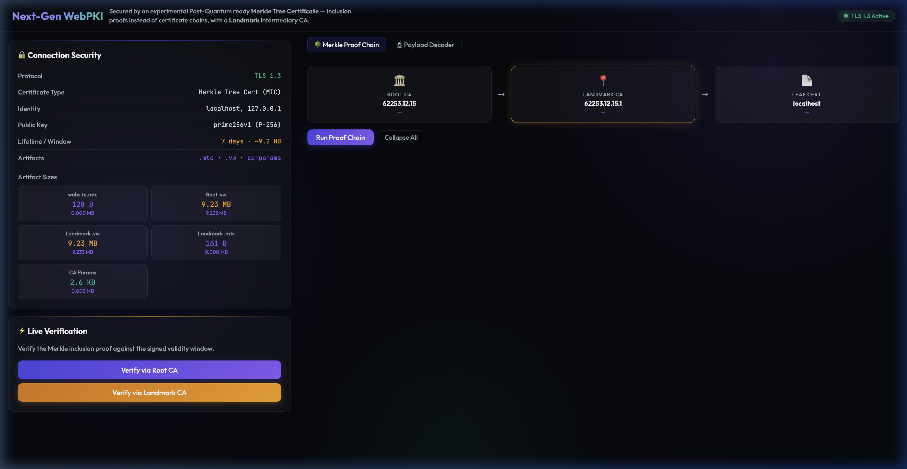
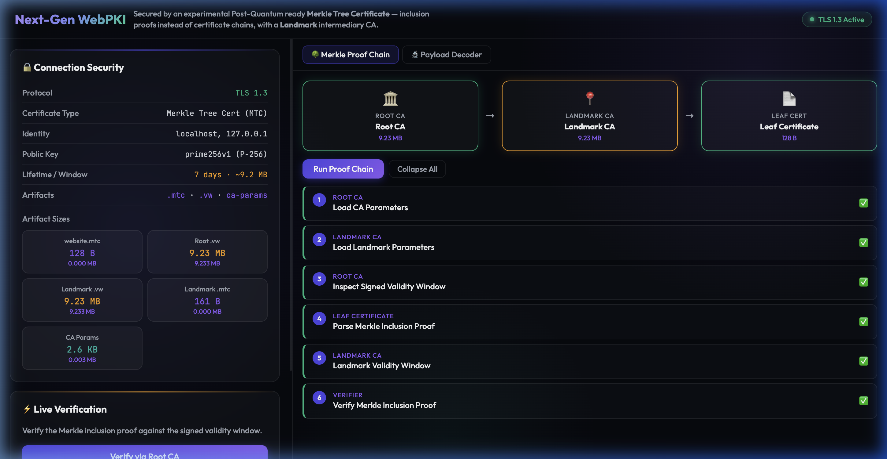
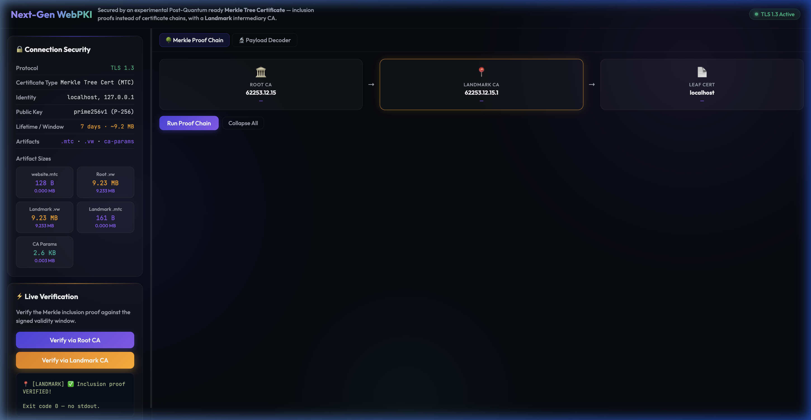

# Merkle Tree Certificates (MTC) Demonstration

[](#)
[](#)
[](#)
[](#)
[](#)

This project provides a fully self-contained, automated demonstration of **Merkle Tree Certificates (MTC)**—an experimental Internet Engineering Task Force (IETF) architectural proposal designed to fix the severe performance bottlenecks caused by massive Post-Quantum Cryptography (PQC) signature sizes in standard TLS handshakes.



## Interactive Proof Chain & Landmark CAs

This demo implements a sophisticated multi-CA hierarchy to address the challenges of large-scale Merkle Tree PKIs:

1.  **Merkle Proof Chain:** Visualizes the entire cryptographic journey from CA public parameters to the final leaf assertion.
2.  **Landmark CA (Intermediary):** Demonstrates how "Landmark" nodes can act as trusted cross-checkpoints, allowing for faster verification and smaller storage requirements on the client.
3.  **Multi-Path Verification:** Compare the results of verifying a certificate against the Root CA vs. a Landmark CA in real-time.

## Features

* **Multi-CA Infrastructure:** Root CA + Landmark CA cross-verification simulation.
* **Live Proof Chain Visualization:** Real-time visual trace of the Merkle inclusion proof.
* **Performance-Optimized Diagnostics:** Smart truncation for 300k+ tree head validity windows.
* **TLS 1.3 Enforcement:** All communication secured with modern TLS 1.3.
* **Interactive Payload Decoder:** Real-time binary structure parsing (CA Params, VW, MTC).
* **Chainguard Hardened:** Built on zero-CVE distroless images for maximum security.



## Running with Docker Compose (Recommended)

The easiest way to run the entire demonstration is using **Docker Compose**:

1. **`mtc-demo-website`**: The main MTC demonstration UI (Port 8443).
2. **`mtc-playground`**: Interactive MTC generation playground (Port 8444).

```bash
docker compose up --build -d
```

Open:
* **MTC Demo Website:** `https://localhost:8443`
* **MTC Playground:** `https://localhost:8444`

## Running from Docker Hub (No Local Build Required)

If you prefer to run the pre-built images directly from Docker Hub without building them locally, use the provided helper script:

```bash
# Run with the default Docker Hub username (jsoehner) and latest tag
./run-from-hub.sh

# Or specify a custom Docker Hub username and tag
./run-from-hub.sh <username> <tag>
```

This script will pull the images, recreate the shared volume, start the services in detached mode, and wait for them to pass health checks.




## Quick Start

### 1. Requirements
* `go` (1.21+)
* `openssl`
* macOS or Linux environment

### 2. Setup the PKI & Generate Payloads
Navigate into the `demo` directory and run the fully automated setup script. This will compile the CLI, initialize the CA, issue a batch containing our `localhost` certificate, and extract the generated payloads.

```bash
chmod +x setup.sh
./setup.sh
```

During setup, you will see a dump of the decoded diagnostic structures printed directly to your terminal.

### 3. Launch the Demo Web Server
Start the Go web server to serve the beautiful UI and diagnostic APIs.

```bash
go run main.go
```

The server will bind to `8443` enforcing **TLS 1.3**.

### 4. Explore the Interface
Open your browser and navigate to:
**`https://localhost:8443`**

*(Note: You will receive a standard browser security warning because the server uses a self-signed X.509 certificate as a fallback, given that mainstream browsers do not natively support MTCs in the handshake just yet. Click `Advanced -> Proceed to localhost`.)*

Once loaded, click **"Verify Merkle Tree Certificate"** to perform a live inclusion proof verification, and use the **Diagnostics Buttons** to decode the various binary payloads.

## Project Structure

```text
/
├── docker-compose.yml   # Multi-container orchestration
├── Dockerfile           # Secure multi-stage build with multiple runtime targets
├── .github/workflows/   # CI/CD pipelines (MTC buildx, security audit, SBOM/CBOM)
├── docs/
│   ├── adr/             # Architecture Decision Records (ADR-0001, ADR-0002)
│   └── security/        # Cryptographic audit & PQC migration reports
├── scripts/             # SBOM/CBOM generators, AST crypto scanner, and test harness
├── demo/                # Main MTC Demonstration
│   ├── setup.sh         # Automates CA creation and certificate issuance
│   ├── main.go          # The Go TLS 1.3 Web Server and verification API
│   └── static/          # Premium frontend UI
└── playground/          # DigiCert MTC Playground
    ├── main.go          # Playground API wrapper
    └── static/          # Playground dashboard UI
```

## Behind the Scenes (How Verification Works)
When you click the "Verify" button on the UI, the Go backend executes the reference verification logic:
```bash
mtc-cli verify -ca-params <ca-params> -validity-window <website.vw> <website.mtc>
```
If the certificate's authentication path successfully hashes up to the tree head checkpoint listed in the validity window, the certificate is implicitly trusted without requiring its own bulky PQC signature!

## Automated SBOM & CBOM Supply Chain Pipeline

This repository implements an automated, dual-engine Software Bill of Materials (SBOM) and Cryptographic Bill of Materials (CBOM) supply chain governance pipeline in compliance with Executive Order 14028, NIST SP 800-218 (SSDF), and NIST IR 8547 PQC transition guidelines.

For full architectural context, evaluation criteria, and trade-offs, see [ADR-0002: Automated SBOM and CBOM Supply Chain Governance Pipeline](docs/adr/0002-automated-sbom-cbom-supply-chain-governance.md).

### CI/CD Workflow Stages (`.github/workflows/sbom-cbom.yml`)

The automated GitHub Actions workflow executes across standard pull request and push triggers:

1. **Dual SBOM Generation (Anchore / Syft):** Produces both CycloneDX JSON (`oss/sbom.cyclonedx.json`) and SPDX JSON (`oss/sbom.spdx.json`) dependency inventories.
2. **CBOM Generation (`cbomkit-action`):** Generates CycloneDX 1.6 Cryptographic Bill of Materials (`oss/cbom.json`) capturing cryptographic primitives, certificates, and protocol configurations.
3. **Semantic AST Cryptographic Scanning (`scripts/scan_crypto_ast.py`):** Parses Go and backend source code ASTs to identify cryptographic instantiations and call sites, reconciling them directly into the CBOM inventory (`oss/crypto-callsites.json`).
4. **Automated Verification Test Harness (`scripts/test_boms.sh`):** Strict CI gate verifying valid JSON syntax, CycloneDX schema conformance, and non-empty cryptographic component counts.
5. **PQC Migration Readiness Assessment (`scripts/analyze_cbom.py`):** Audits cryptographic assets against NIST Post-Quantum Cryptography standards (ML-KEM, ML-DSA, SLH-DSA vs. quantum-vulnerable RSA/ECC) and publishes a GitHub Actions Step Summary.
6. **Continuous Governance Publishing:** Publishes cryptographic audit summaries to `docs/security/CRYPTOGRAPHIC_AUDIT.md` on `main` branch pushes.
7. **Artifact Archiving:** Uploads all generated BOM artifacts with 90-day retention.

### Local Tooling & Developer CLI (`scripts/`)

Developers can run the exact same generation, analysis, and verification steps locally:

* **Generate BOMs locally:**
  ```bash
  # Scan source directory
  bash scripts/generate_boms.sh -t dir .

  # Scan container image
  bash scripts/generate_boms.sh -t docker merkle-demo:local
  ```

* **Semantic AST Cryptographic Scan & Reconciliation:**
  ```bash
  python3 scripts/scan_crypto_ast.py . --cbom oss/cbom.json --output-json oss/crypto-callsites.json
  ```

* **Run BOM Verification Test Harness:**
  ```bash
  bash scripts/test_boms.sh oss
  ```

* **Analyze CBOM & PQC Readiness Dashboard:**
  ```bash
  python3 scripts/analyze_cbom.py oss/cbom.json \
    --sbom oss/sbom.cyclonedx.json \
    --markdown docs/security/CRYPTOGRAPHIC_AUDIT.md \
    --json oss/crypto-analysis.json
  ```

* **OCI Referrers & Attestation Utilities:**
  ```bash
  # Query OCI 1.1 CBOM referrers without pulling image layers
  python3 scripts/fetch_oci_cbom.py <IMAGE_REF> -o oss/upstream_cbom.json

  # Attach generated CBOM artifact to an OCI registry via ORAS
  bash scripts/attach_oci_bom.sh oss/cbom.json <IMAGE_REF>
  ```

